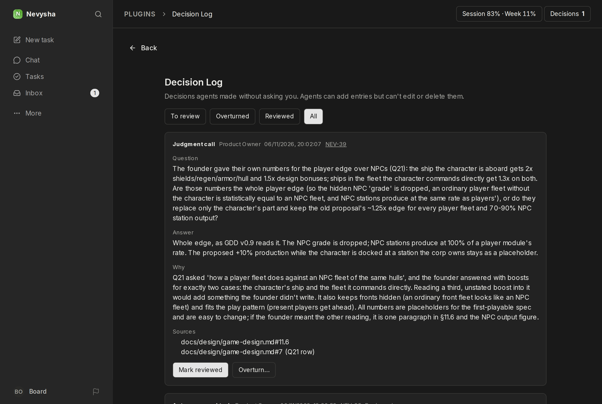
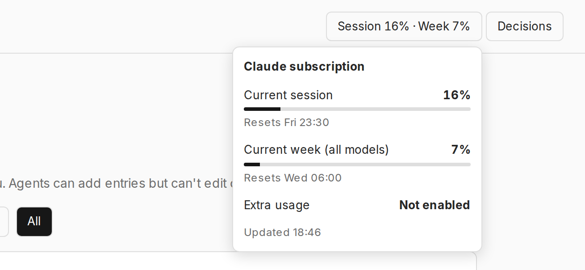
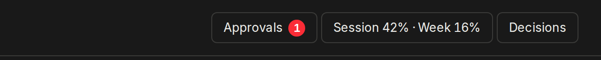
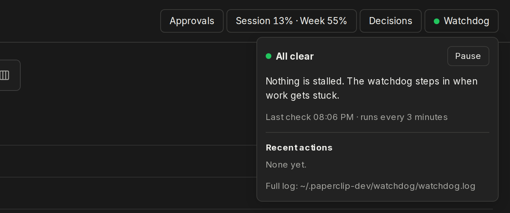
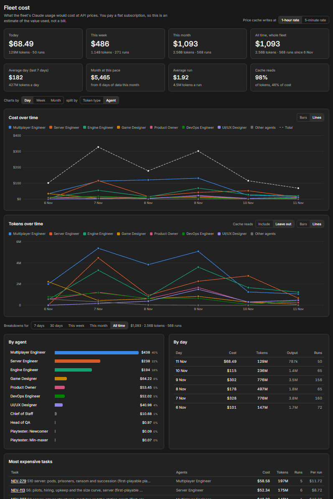
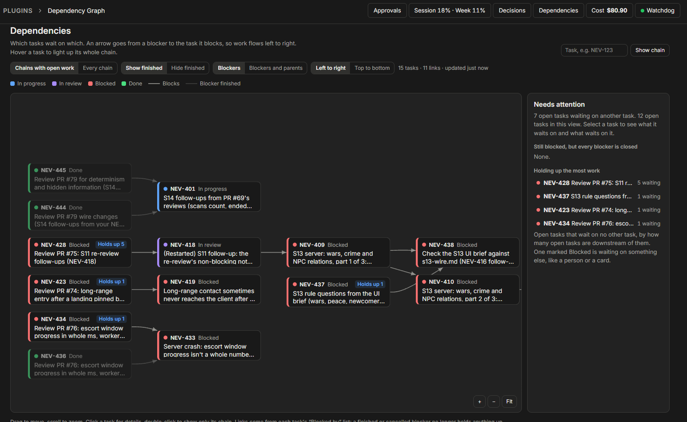

# Paperclip plugins

Private plugins for my local Paperclip instance.

## [`decision-log`](decision-log/README.md)

An in-app log of decisions agents made without asking, with founder review.



## [`claude-usage`](claude-usage/README.md)

Claude subscription usage in the header, plus a limit that pauses the routines you choose without using any Claude usage.



## [`approvals-button`](approvals-button/README.md)

An **Approvals** button in the header, with a flag showing how many are pending, because the app's menus don't link to that page.



## [`watchdog`](watchdog/README.md)

A **Watchdog** button in the header showing whether the watchdog (a timer outside Paperclip that restarts stalled work) is running, what it did recently, and which tasks wait on CI, with pause and resume.



## [`fleet-cost`](fleet-cost/README.md)

A **Fleet Cost** page showing what the fleet's Claude usage would cost at API prices, per day, week, month, agent and task, with token usage. There's also a header button with today's cost.



## [`dependency-graph`](dependency-graph/README.md)

A **Dependencies** page drawing which tasks wait on which as a graph, flagging stale waits, loops and the tasks holding up the most work. There's also a header button with the number of stale waits.



## Setup

Each plugin is its own package. Paperclip loads it from its folder, so after a fresh clone, run this in the folder and then install it:

```sh
pnpm install && pnpm build
curl -X POST http://localhost:3100/api/plugins/install -H 'content-type: application/json' \
  -d "{\"packageName\":\"$PWD\",\"isLocalPath\":true}"
```

`.paperclip-sdk/` holds the SDK snapshots each plugin builds against, so a clone builds without a Paperclip checkout.
