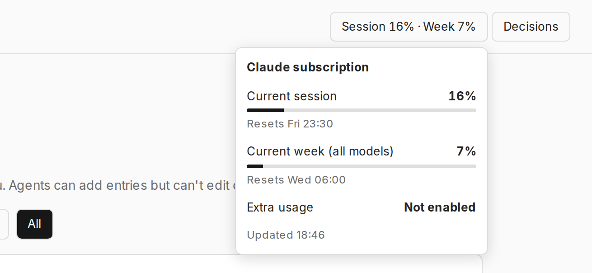

# Claude Usage

A Paperclip plugin that shows your Claude subscription usage in the header, like `/usage` in Claude Code.
Click it for all windows and reset times, and to set which routines pause at a usage limit.



The plugin reads the login in `~/.claude/.credentials.json` (or `CLAUDE_CONFIG_DIR`), sends the token only to
`api.anthropic.com/api/oauth/usage`, and never returns or logs it. Results are cached for 2 minutes. It doesn't
refresh the login: when the token expires, running `claude` on this machine renews it.

The usage shown is for the account logged in to Claude Code on this machine.

Every 5 minutes it also writes `~/.paperclip-dev/claude-usage.json` (or `CLAUDE_USAGE_FILE`), with percentages, reset times and the settings below, so agents can check usage without touching the login or the local API.

## Pausing routines

The panel has two usage limits, one for the 5-hour session and one for the week, and a list of routines. Every 5 minutes, checked routines pause when either window reaches its limit, and resume when it drops. The weekly limit defaults to the session one until you set it. Both are published in `~/.paperclip-dev/claude-usage.json` (`gate.pauseAtPercent`, `gate.weekPauseAtPercent`), and the watchdog uses them too. This runs in the plugin, so it uses no Claude usage.

- Only routines declared in `src/gate.ts` can be listed, because a plugin can only pause routines it owns. To add one, add it there. New capabilities aren't needed.
- Each company picks its routines in the plugin settings (see below). The plugin creates a routine in a company only when that company's settings name it with an assignee, and it re-applies the assignee and project on every check. Without settings, the plugin manages no routines in that company.
- The limits are shared by the whole instance. Which routines are checked is saved per company.
- A routine you paused by hand stays paused. If you resume one while usage is over the limit, the next check pauses it again.
- If usage can't be read, routines the plugin paused resume, so a broken login can't silently stop them.
- It only stops new scheduled runs, not work already running.
- If you uninstall the plugin, its routines stay as they are, including any that are paused.

## Settings

Set them per company in the plugin settings, or with `POST /api/plugins/nevysha.claude-usage/config` and `{"companyId":"...","configJson":{...}}`:

| Setting | Default | Use |
| --- | --- | --- |
| `projectId` | none | The project the managed routines file their tasks in |
| `routines` | `[]` | A list of `{"key": "...", "assigneeAgentId": "..."}`; `key` is one of the keys in `src/gate.ts` |

For example:

```json
{
  "projectId": "<project id>",
  "routines": [
    { "key": "po-review", "assigneeAgentId": "<agent id>" },
    { "key": "safety-review", "assigneeAgentId": "<agent id>" }
  ]
}
```

The plugin runs its checks for every company, so it needs the `companies.read` capability.
Paperclip lets the unattended checks act only in companies that have a config row, so a company without one is skipped.

When a company's settings stop listing a routine that the plugin paused, the next check resumes it and stops managing it.

### Upgrading from 0.3

Before 0.4.0 the company, project and assignees were constants in `src/worker.ts`, and the checkboxes were saved for the whole instance.
After the upgrade, add those values to your company's settings.
Until you do, the plugin leaves that company's routines as they are, including any it had paused.
The first company with routines in its settings takes over the saved checkboxes, so routines the gate had paused resume when usage drops.

## Development

```sh
pnpm install && pnpm typecheck && pnpm test && pnpm build
```

Paperclip loads the plugin from this folder, so don't move it.
