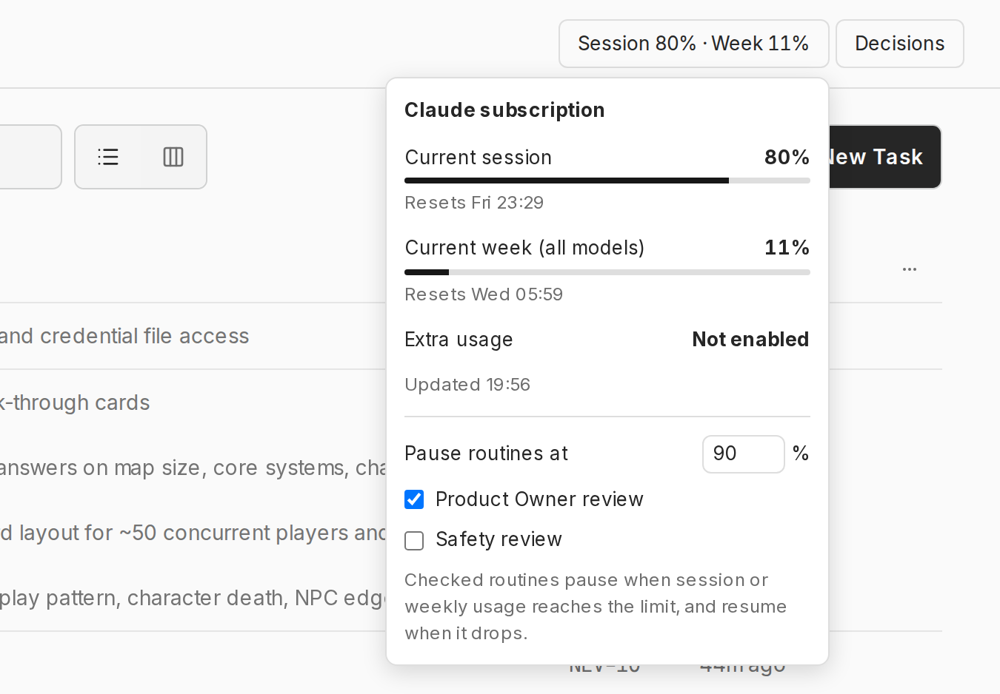

# Claude Usage

A Paperclip plugin that shows your Claude subscription usage in the header, like `/usage` in Claude Code.
Click it for all windows and reset times.



The plugin reads the login in `~/.claude/.credentials.json` (or `CLAUDE_CONFIG_DIR`), sends the token only to
`api.anthropic.com/api/oauth/usage`, and never returns or logs it. Results are cached for 2 minutes. It doesn't
refresh the login: when the token expires, running `claude` on this machine renews it.

The usage shown is for the account logged in to Claude Code on this machine.

Every 5 minutes it also writes `~/.paperclip-dev/claude-usage.json` (or `CLAUDE_USAGE_FILE`), with percentages, reset times and the settings below, so agents can check usage without touching the login or the local API.

## Pausing routines

The panel has a usage limit and a list of routines. Every 5 minutes, checked routines pause when session or weekly usage reaches the limit, and resume when it drops. This runs in the plugin, so it uses no Claude usage.

- Only routines declared in `src/gate.ts` can be listed, because a plugin can only pause routines it owns. To add one, add it there and in `ASSIGNEES` in `src/worker.ts`. New capabilities aren't needed, but new routines are created on the next check.
- A routine you paused by hand stays paused. If you resume one while usage is over the limit, the next check pauses it again.
- If usage can't be read, routines the plugin paused resume, so a broken login can't silently stop them.
- It only stops new scheduled runs, not work already running.
- If you uninstall the plugin, its routines stay as they are, including any that are paused.
- Company, project and agent IDs are constants in `src/worker.ts`. Unattended checks also need a config row for that company, or Paperclip denies them with "company context is required". After a reinstall, set it with `POST /api/plugins/nevysha.claude-usage/config` and `{"companyId":"...","configJson":{}}`.

## Development

```sh
pnpm install && pnpm typecheck && pnpm test && pnpm build
```

Paperclip loads the plugin from this folder, so don't move it.
