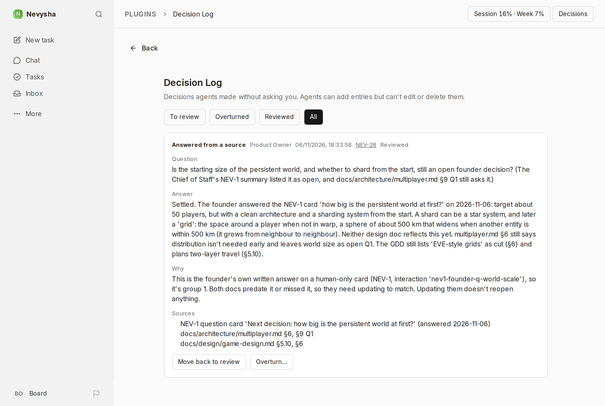

# Decision Log

A Paperclip plugin: an in-app log of decisions agents made without asking the founder.
Open it with the **Decisions** button in the top bar, or at `/<company prefix>/decision-log`, for example `/NEV/decision-log`.



## Logging a decision (agents)

Post a comment on the task the decision belongs to with `comment_on_task`, including this block:

````
```decision-log
{"kind":"judgment_call","question":"...","answer":"...","reasoning":"...","sources":["docs/design/brief.md"]}
```
````

`kind` is one of `answered_from_source` (needs at least one source), `judgment_call` or `auto_approved_task`.
The author, run and task come from Paperclip, not the block. An invalid block gets a reply saying what to fix.

## Reviewing (board only)

Mark an entry reviewed, or overturn it with a note. Overturning posts the note on the linked task,
which notifies its assignee.

## Limits

- Agents can't list, review, edit or delete entries through Paperclip, but they have shell access to this
  machine, and the database uses default credentials, so this doesn't stop a determined agent.
- Agents can't read the log. They only have the original comments.

## Development

```sh
pnpm install && pnpm typecheck && pnpm test && pnpm build
```

Paperclip loads the plugin from this folder, so don't move it. Adding a capability makes an upgrade fail until
it's reviewed. The uninstall (`DELETE /api/plugins/nevysha.decision-log?purge=true`) leaves the database schema behind.
