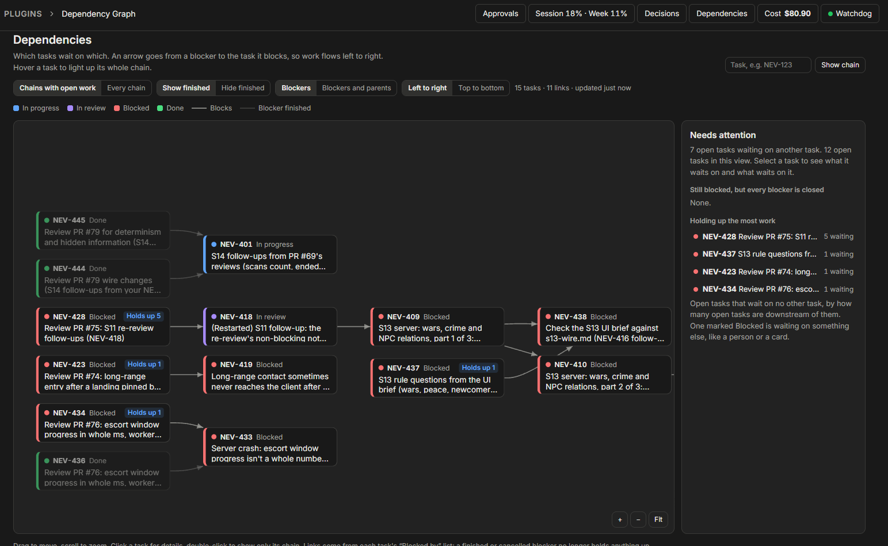

# Dependency Graph

A **Dependencies** page that draws which tasks wait on which, as a graph, and what blocked tasks wait on outside Paperclip: background jobs, CI, or you. Paperclip stores the task links (a task's "Blocked by" list) but only shows them one task at a time.



## What it shows

- **The graph:** one box per task, coloured like Paperclip's statuses. An arrow goes from a blocker to the task it blocks, so work flows left to right (or top to bottom). An arrow from a finished or cancelled blocker is faint, because it no longer holds anything up.
- **Wait boxes** (dashed), linked to the task they hold up:
  - **Job:** a running process that will call `paperclip-notify` for the task when it ends, the pattern agents use for long runs (`setsid nohup ... bash -c '<command>; paperclip-notify NEV-123 ...'`, or a `job-NEV-123-<name>` systemd user unit). It shows the command, how long it has run, and the last line of its log. **Quiet** means the log hasn't changed for 30 minutes.
  - **CI:** a CI wait an agent registered with `paperclip-wait`.
- **Blocked tasks are always drawn**, even with no links, so a lone blocked task is visible.
- **Which chains:**
  - by default, only chains that still have an open task;
  - or every chain;
  - or one task's chain: everything upstream and downstream of it. Open it with the search box, by double-clicking a task, with **Show only this chain**, or with a link to `/<prefix>/dependencies?focus=NEV-123`.
- **Options:** hide finished tasks, add dashed parent → sub-task links, switch direction, and pick a project (only when there's more than one). The page remembers these choices in your browser.
- **Hover** a task to light up its whole chain. **Click** it for the side panel: assignee, priority, last update, what it waits on, what it blocks, its parent task, and a link to open it.
- **Flags on tasks:**
  - **Stale:** still marked blocked, but every task it waits on is closed. Paperclip should have woken it, so it needs a nudge. This overlaps with the overview-tool idea in NEV-390.
  - **Holds up N:** open, waits on no other task, and has N open tasks downstream. This is where a chain has to move. It may still be marked Blocked for another reason, such as waiting on a person or a card.
  - **Loop:** tasks that wait on each other in a circle, so none of them can start.
  - **Needs you:** blocked, with no open blocker and nothing running, and its unblock note names the board or a user.
  - **No wake-up:** blocked, with no open blocker, no running job, no CI wait, and no person named. Nothing will wake it; often a background job that died.
- **Waiting for** (in a task's side panel): the task's unblock note (who it waits on and for what, which agents set when they block a task), and the details of its jobs and CI waits.
- **Needs attention** (the side panel when nothing is selected): what waits on you, blocked tasks nothing will wake, quiet jobs, stale waits, loops, and the tasks holding up the most work.
- A **Dependencies** button in the header, with an amber count of tasks waiting on you, blocked tasks nothing will wake, and stale waits. A sidebar link exists too, but the coordinator sidebar doesn't show plugin links.

The page refreshes every 30 seconds. Drag to move, scroll to zoom, or use **+**, **−** and **Fit**. Fit never shrinks the graph below a readable size; a bigger graph starts at its top left.

## How it works

The worker reads `issues` (including `unblock_descriptor`, the unblock note), `issue_relations` (type `blocks`: `issue_id` blocks `related_issue_id`), `agents` and `projects` for the company. It writes nothing and owns no tables. Outside the database it scans `/proc` for processes whose command line calls `paperclip-notify NEV-123` (`src/waits.ts`), following their standard output to the log file, and reads the CI waits in the watchdog's `~/.paperclip-dev/watchdog/waits.json`. A job that dies simply disappears, so nothing has to be registered or cleaned up. The page does the analysis (`src/graph.ts`) and lays the graph out with [dagre](https://github.com/dagrejs/dagre), pinned to 3.1.3 and bundled into the UI.

## Develop

```sh
pnpm install
pnpm test && pnpm typecheck && pnpm build
```

After a rebuild, reload the plugin: POST `/api/plugins/<id>/disable`, then `/enable`.
