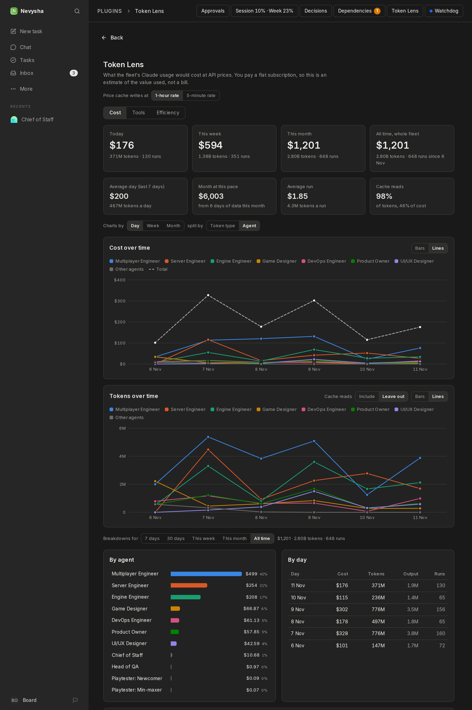
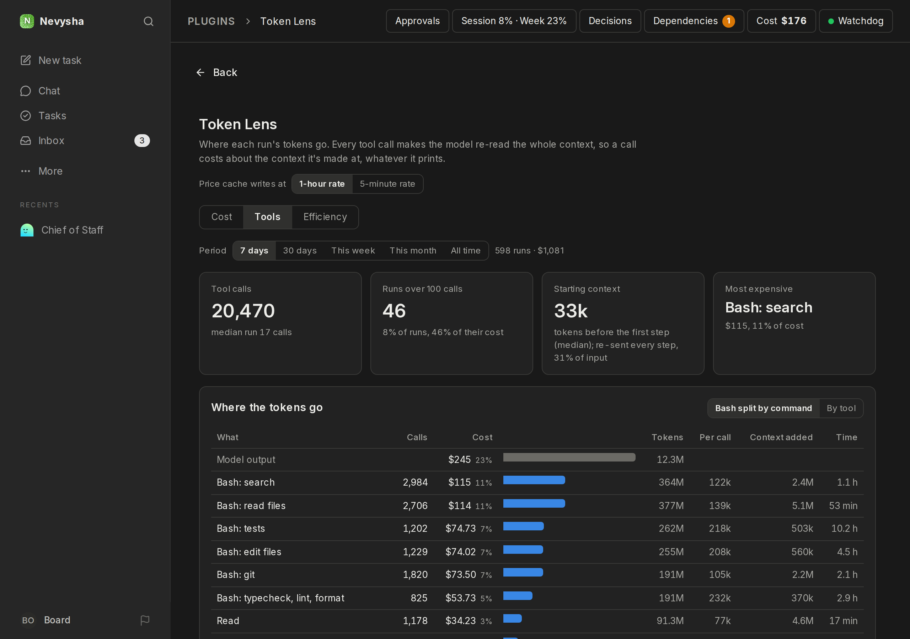
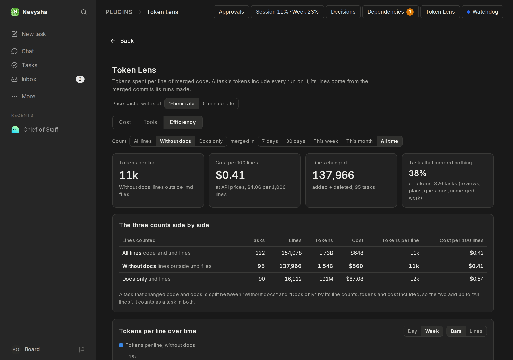

# Token Lens

Where the fleet's Claude tokens go. One page with three tabs:

- **Cost:** what the usage would cost at API prices, next to its token usage. The fleet runs on a subscription, so Paperclip's own Costs page shows $0. This tab puts a price on the same tokens.
- **Tools:** what each kind of tool call costs, calls per run, runs over 100 calls, and each run's starting context.
- **Efficiency:** tokens and cost per changed line of merged code, counted three ways: all lines, without docs (`.md`), and docs only.

The plugin was called Fleet Cost; its ID (`nevysha.fleet-cost`) and page URL (`/<company>/fleet-cost`) are unchanged.

## Cost tab



### What it shows

- **Totals:** today, this week (from Monday), this month and all time. Each shows cost, tokens and runs.
- **Rates:** the average day over the last 7 days, the month's projected total at the current pace, the average run, and the share of tokens and of cost that comes from cache reads.
- **Cost over time:** by day, week or month, split by token type (cache reads, cache writes, output, input) or by agent. The 7 agents with the highest all-time cost get their own colour, and the rest share "Other agents". Colours stay with the agent when you change the period.
- **Tokens over time:** grouped and split the same way as the cost chart, with its points under the cost bars. Cache reads are about 98% of all tokens and dwarf the rest, so a switch leaves them out to compare the other types.
- **Bars or lines:** each chart has its own switch, remembered in your browser. Cost defaults to stacked bars, which show the total as the bar height; as lines it adds a dashed **Total** line. Tokens default to lines, one per token type or agent; as bars they stack, which reads best with cache reads left out.
- **Breakdowns** for 7 days, 30 days, this week, this month or all time:
  - cost per agent, with a token breakdown on hover;
  - cost per day;
  - the 20 most expensive tasks, linked to the task.
- A **Cost** button in the header with today's cost. A sidebar link exists too, but the coordinator sidebar doesn't show plugin links.

## Tools tab



- Calls per tool, with Bash split by command: file reads (`sed -n`, `cat`), searches (`grep`, `find`, `ls`), tests, local CI, typecheck and lint, git, gh, file edits, polling loops and so on. A chained command counts by its first real command.
- **What each call costs.** Every tool call is followed by a model request that re-sends the whole context, so a call costs about the context it's made at, even when it prints one line. The collector reads each run's context after every step and charges each call the request that follows it. **Context added** is what the call's result put into the context. **Run start** is each run's first request (instructions, tools and task) and **Model output** is what the model wrote. A run's rows are scaled to its usage receipt, so they add up to it exactly (unscaled, they match within a few percent).
- Calls per run over time (median, 90th percentile, runs over 100 calls), per-agent medians and peak context, and the list of runs over 100 calls.

## Efficiency tab



- **Lines** are the additions and deletions of each merged PR's own commits, before the squash. Lockfiles and binary files are left out; `.md` and `.mdx` count as docs.
- **Which task a commit belongs to:** the task of the run that made it. The collector finds that run through its `git commit` commands: the hash git printed, or else the commit's first line matched against the commit messages the runs used. Commits from before runs recorded tool calls (the `claude_local` night of Nov 8–9) and merge commits fall back to the task named in the PR title.
- **A task's tokens** are every run on it, including reviews and retries on that task. Tasks that merged nothing (reviews on their own task, plans, questions, unmerged work) are shown as a share of tokens.
- The three counts: **All lines** (code and docs); **Without docs** (lines outside `.md`); **Docs only** (`.md` lines). A task that changed both is split run by run: each run that made merged commits gives its own tokens and cost to the code and doc lines of those commits, and the task's other runs (reviews, plans, retries, runs whose commits weren't matched) are split by the task's line counts. So a task whose code was written in one run and its docs in another shows what each cost. Within a single commit, or a single run, a doc line and a code line still cost the same. Without docs plus docs only is exactly all lines, in lines, tokens and cost. Tokens per line and cost per line don't add up: the all-lines figure is the average of the other two, weighted by their lines.
- Line counts are a rough measure of work: good for trends and outliers, not for ranking agents against each other.

## The collector

Paperclip doesn't let a plugin read run events (where tool calls are) or call localhost, so `collector/collect.mjs` runs outside it. Every 15 minutes it:

1. reads finished runs' tool and usage events from Postgres and posts per-run summaries to the plugin's `POST /ingest` route;
2. lists merged PRs (space-4x from the host's Forgejo, with the read-only token in `~/.config/space4x/forgejo-tools-token`; repos still on GitHub with `gh` and the agents' limited token, `GH_CONFIG_DIR=~/.config/space4x/gh`; set the list with `TOKEN_LENS_REPOS`, where `forgejo:owner/name` means Forgejo), keeps a bare mirror of each repository in `~/.cache/token-lens/` (fetching `refs/pull/*/head`) for per-commit line counts, matches commits to runs, and posts them.

It does nothing when Paperclip isn't answering and never starts it. Its timer doesn't start at boot either: `paperclip-start` (in [`ops/`](../ops/)) starts it, with a first pass 2 minutes later, and `paperclip-stop` stops it. Its cursor is in `~/.local/state/token-lens/state.json`; `--full` re-sends everything, `--dry-run` prints instead of posting.

```sh
GH_CONFIG_DIR=~/.config/space4x/gh node collector/collect.mjs          # one pass
systemctl --user link $PWD/collector/systemd/token-lens-collect.{service,timer}
systemctl --user start token-lens-collect.timer                         # every 15 minutes, until stopped
journalctl --user -u token-lens-collect -n 20                           # its log
```

The plugin stores the summaries in its own tables (`migrations/001_token_lens.sql`) and joins them with the runs, agents and tasks it can read.

## How the price is worked out

The worker reads the usage receipt of every run (`heartbeat_runs.usage_json`: input, cache-write, cache-read and output tokens, plus the model). The page applies Claude API list prices (`src/pricing.ts`):

| Model | Input | Cache read | Cache write (5 min / 1 h) | Output |
|---|---|---|---|---|
| claude-opus-5-5 | $4 | $0.20 | $5 / $8 | $20 |
| claude-sonnet-5-5 | $2 | $0.10 | $2.50 / $4 | $10 |

Prices are per million tokens. Runs don't record which cache-write duration applied, so a toggle on the page picks the rate. It defaults to the 1-hour rate, the same conservative choice Paperclip's own estimate makes. Runs without a model are priced as Opus 5.5. Days use the viewer's time zone.

When prices change, edit `RATES` and `PRICES_AS_OF` in `src/pricing.ts`, then rebuild.

## Develop

```sh
pnpm install
pnpm test && pnpm typecheck && pnpm build   # tests cover pricing, the views, ingest and the collector logic
```

After a rebuild, reload the plugin: POST `/api/plugins/<id>/disable`, then `/enable`.
