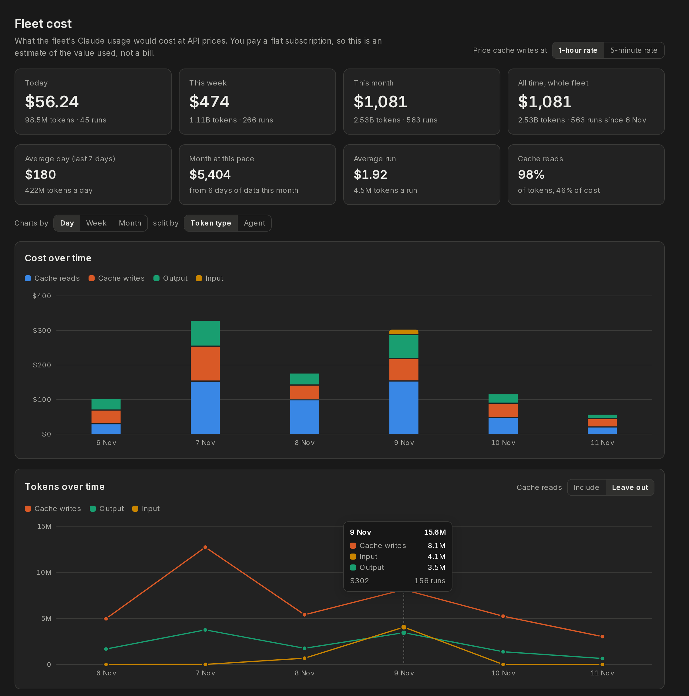
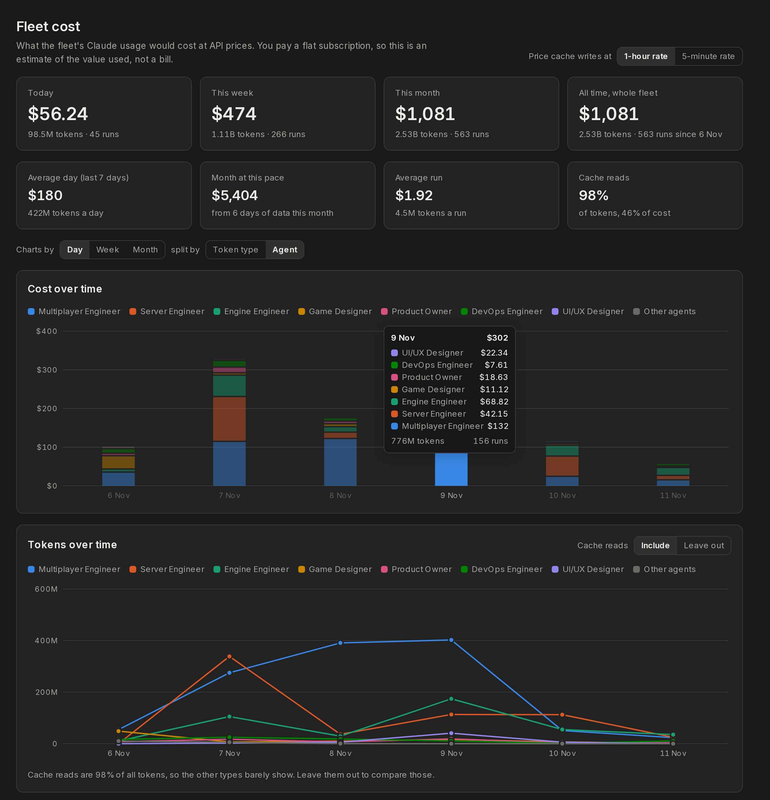

# Fleet Cost

A **Fleet Cost** page showing what the fleet's Claude usage would cost at API prices, next to its token usage. The fleet runs on a subscription, so Paperclip's own Costs page shows $0. This page puts a price on the same tokens.



Split by agent, the same two charts show each agent's share, here with a tooltip on the cost bar for 9 Nov:



## What it shows

- **Totals:** today, this week (from Monday), this month and all time. Each shows cost, tokens and runs.
- **Rates:** the average day over the last 7 days, the month's projected total at the current pace, the average run, and the share of tokens and of cost that comes from cache reads.
- **Cost over time:** bars by day, week or month, split by token type (cache reads, cache writes, output, input) or by agent. The 7 agents with the highest all-time cost get their own colour, and the rest share "Other agents". Colours stay with the agent when you change the period.
- **Tokens over time:** one line per token type (or per agent), grouped and split the same way as the cost chart, with its points under the cost bars. Cache reads are about 98% of all tokens and dwarf the rest, so a switch leaves them out to compare the other types.
- **Breakdowns** for 7 days, 30 days, this week, this month or all time:
  - cost per agent, with a token breakdown on hover;
  - cost per day;
  - the 20 most expensive tasks, linked to the task.
- A **Cost** button in the header with today's cost. A sidebar link exists too, but the coordinator sidebar doesn't show plugin links.

## How the price is worked out

The worker reads the usage receipt of every run (`heartbeat_runs.usage_json`: input, cache-write, cache-read and output tokens, plus the model). It reads nothing else and writes nothing. The page applies Claude API list prices (`src/pricing.ts`):

| Model | Input | Cache read | Cache write (5 min / 1 h) | Output |
|---|---|---|---|---|
| claude-opus-5-5 | $4 | $0.20 | $5 / $8 | $20 |
| claude-sonnet-5-5 | $2 | $0.10 | $2.50 / $4 | $10 |

Prices are per million tokens. Runs don't record which cache-write duration applied, so a toggle on the page picks the rate. It defaults to the 1-hour rate, the same conservative choice Paperclip's own estimate makes. Runs without a model are priced as Opus 5.5. Days use the viewer's time zone.

When prices change, edit `RATES` and `PRICES_AS_OF` in `src/pricing.ts`, then rebuild.

## Develop

```sh
pnpm install
pnpm test && pnpm typecheck && pnpm build
```

After a rebuild, reload the plugin: POST `/api/plugins/<id>/disable`, then `/enable`.
