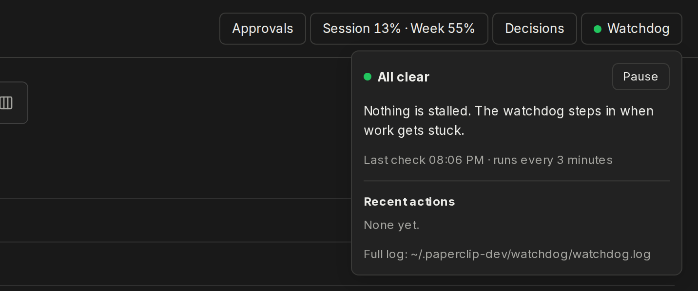

# Watchdog

A Paperclip plugin that adds a **Watchdog** button to the header, showing whether the watchdog is keeping work moving.

The watchdog itself isn't part of the plugin. It's a systemd user timer that runs every 3 minutes outside Paperclip, so it keeps working when Paperclip freezes. It doesn't start at boot: start the timer with Paperclip and stop it after. Its source is in [`host/`](host/). Each run, it:
- restarts Paperclip when a company-wide quarantine stops every agent run, with the `restartCommand` from its config (without one, it only reports it);
- reports tasks Paperclip won't restart (held by a platform error), for a person to look at;
- reports wake loops: an agent restarting on the same task again and again with nothing to do;
- moves stalled `blocked` tasks back to `todo`, except when Paperclip already woke the agent because the task's blockers finished and the agent chose to stay blocked;
- adds the **Sliced** label to open tasks whose description starts with `Sized: one run`, since agents can't set labels themselves;
- notes when a Forgejo repo's GitHub mirror of `main` has differed from Forgejo for over 15 minutes.

It never wakes a task just because it's idle: an assigned `todo` task is left to Paperclip and its agent. It doesn't relay CI results either: an agent waiting on CI keeps its task in progress and sets a Paperclip monitor on it (`executionPolicy.monitor`), and Paperclip wakes it to check.

The steps that start agent runs pause while Claude usage is at or over the limits in `~/.paperclip-dev/claude-usage.json`: `gate.pauseAtPercent` for the 5-hour session and `gate.weekPauseAtPercent` for the week. That file comes from the [claude-usage](../claude-usage/README.md) plugin. Without it, or when it's over 30 minutes old, nothing is gated and the panel says so. When the session limit resets, the watchdog forgets its per-task cooldowns once, so tasks that stalled on the limit are picked up on the next run instead of hours later.

The plugin only reads the watchdog's files in `~/.paperclip-dev/watchdog/` and toggles its pause flag.



The button's dot shows the watchdog's state:

| Dot | Meaning |
|---|---|
| Green | All clear |
| Blue | Acted in the last 15 minutes |
| Red | Quarantine or error |
| Yellow | Paused |
| Grey | Not running: no check in 10 minutes, or no report yet |

The panel shows:
- the last check;
- any notes, such as usage being too high to wake agents;
- the last 10 actions;
- a **Pause** / **Resume** button.

## The host side

`host/` holds everything that runs outside Paperclip:

| File | What it is |
|---|---|
| `watchdog.mjs` | The watchdog. `--dry-run` logs what it would do without changing anything. |
| `paperclip-notify` | Agents end a detached background job with `paperclip-notify ABC-123 "<result>"`. It posts a board comment that wakes the task's owner. It doesn't need the watchdog: it only calls Paperclip's API. The Dependencies page shows the jobs that will call it. |
| `paperclip-watchdog.service`, `.timer` | The systemd user units. |
| `config.example.json` | What goes in `~/.paperclip-dev/watchdog/config.json` (see below). |
| `install.sh` | Symlinks the scripts into `~/.local`, installs the units, and leaves the timer off at boot. It also removes the link to `paperclip-wait`, which no longer exists. |

The symlinks make this folder the live copy, so pulling changes updates the watchdog. Run `install.sh` again after changing the unit files. For the timer to run when nobody is logged in, turn on lingering: `sudo loginctl enable-linger $USER`.

### Config

The watchdog reads `~/.paperclip-dev/watchdog/config.json`. Without a `companyId` the watchdog does nothing.

| Key | What it is |
|---|---|
| `companyId` | The Paperclip company to watch. |
| `repos` | Optional. Forgejo repos whose `main` should be mirrored to GitHub: `{ "name", "forgejo": "owner/name", "githubMirror": "owner/name" }`. Repos without both are ignored. |
| `ghConfigDir` | The `gh` login used to read the mirrors, ideally one with a limited token. Default: `gh`'s own. |
| `forgejo` | `url` and `tokenFile`, a file holding a read-only token, for the mirror check. `FORGE_URL` overrides the URL. |
| `restartCommand` | How to restart Paperclip, as a list, e.g. `["bash", "-lc", "paperclip-stop && paperclip-start"]`. It should refuse to stop Paperclip while runs are live. Without it the watchdog never restarts Paperclip. |

The watchdog's own files are in `~/.paperclip-dev/watchdog/`:
- `watchdog.log`: every action.
- `status.json`: what the button reads.
- `state.json`: its memory between runs.
- `paused`: create this file to pause the watchdog.

## Development

```sh
pnpm install && pnpm typecheck && pnpm test && pnpm build
```

Paperclip loads the plugin from this folder, so don't move it. `PAPERCLIP_WATCHDOG_DIR` points the worker at another folder, which the tests use.
