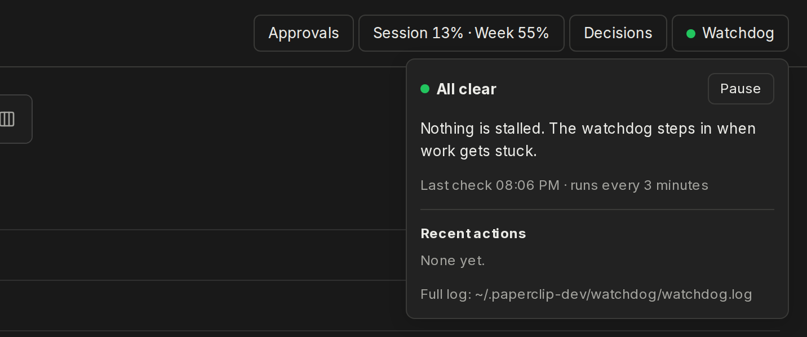

# Watchdog

A Paperclip plugin that adds a **Watchdog** button to the header, showing whether the watchdog is keeping work moving.

The watchdog itself isn't part of the plugin. It's a systemd user timer that runs every 3 minutes outside Paperclip, so it keeps working when Paperclip freezes. Its source is in [`host/`](host/). Each run, it:
- restarts Paperclip when a company-wide quarantine stops every agent run;
- recreates tasks Paperclip won't restart;
- moves stalled `blocked` tasks back to `todo`;
- wakes idle `todo` tasks;
- comments CI results on the tasks waiting for them.

The plugin only reads the watchdog's files in `~/.paperclip-dev/watchdog/` and toggles its pause flag.



The button's dot shows the watchdog's state:

| Dot | Meaning |
|---|---|
| Green | All clear |
| Blue | Acted in the last 15 minutes |
| Red | Quarantine or error |
| Yellow | Paused |
| Grey | Not running: no check in 10 minutes, or no report yet |

The panel shows:
- the last check;
- any notes, such as usage being too high to wake agents;
- CI waits that agents registered with `paperclip-wait`, each with a **Remove** button;
- the last 10 actions;
- a **Pause** / **Resume** button.

## The host side

`host/` holds everything that runs outside Paperclip:

| File | What it is |
|---|---|
| `watchdog.mjs` | The watchdog. `--dry-run` logs what it would do without changing anything. |
| `paperclip-wait` | Agents run `paperclip-wait NEV-123 --ci <branch or commit>` to register a CI wait. The watchdog comments on the task when CI finishes, which wakes its owner. |
| `paperclip-notify` | Agents end a detached background job with `paperclip-notify NEV-123 "<result>"`. It posts a board comment that wakes the task's owner. |
| `paperclip-watchdog.service`, `.timer` | The systemd user units. |
| `install.sh` | Symlinks the scripts into `~/.local`, installs the units and enables the timer. |

The symlinks make this folder the live copy, so pulling changes updates the watchdog. Run `install.sh` again after changing the unit files. For the timer to run when no WSL session is open, turn on lingering: `sudo loginctl enable-linger $USER`.

The watchdog's own files are in `~/.paperclip-dev/watchdog/`:
- `watchdog.log`: every action.
- `status.json`: what the button reads.
- `state.json`: its memory between runs.
- `waits.json`: registered CI waits.
- `paused`: create this file to pause the watchdog.

## Development

```sh
pnpm install && pnpm typecheck && pnpm test && pnpm build
```

Paperclip loads the plugin from this folder, so don't move it. `PAPERCLIP_WATCHDOG_DIR` points the worker at another folder, which the tests use.
